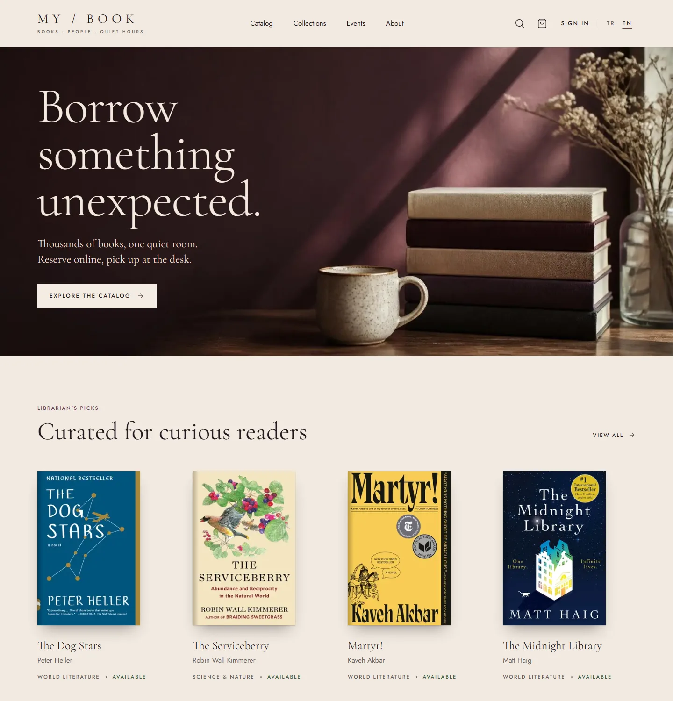
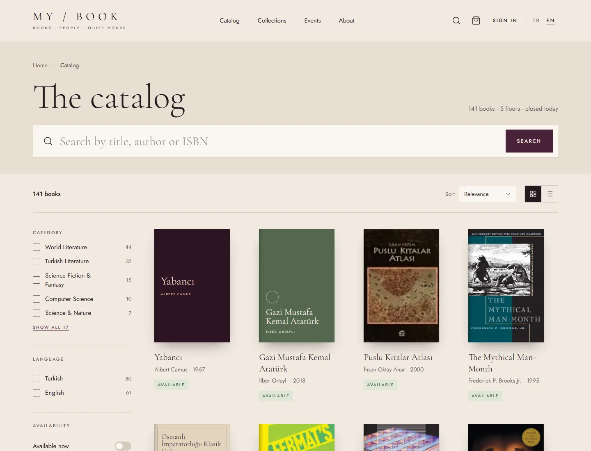
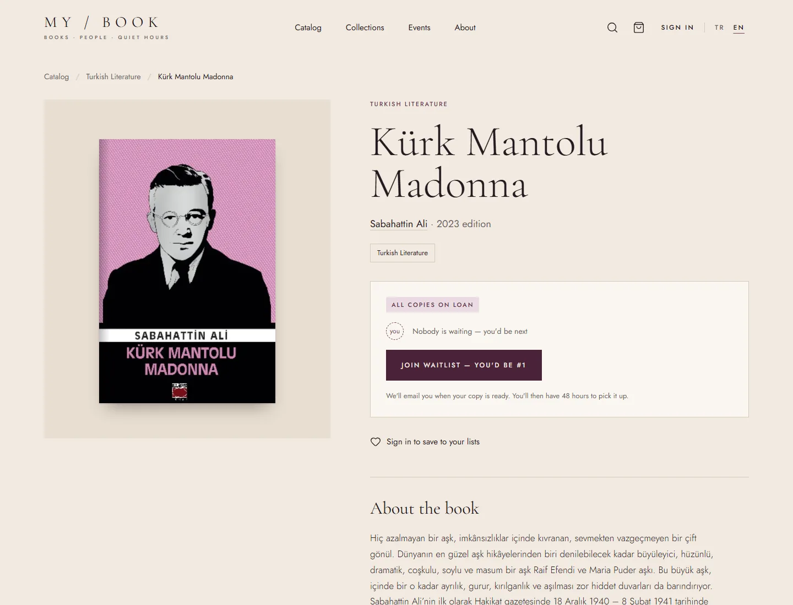
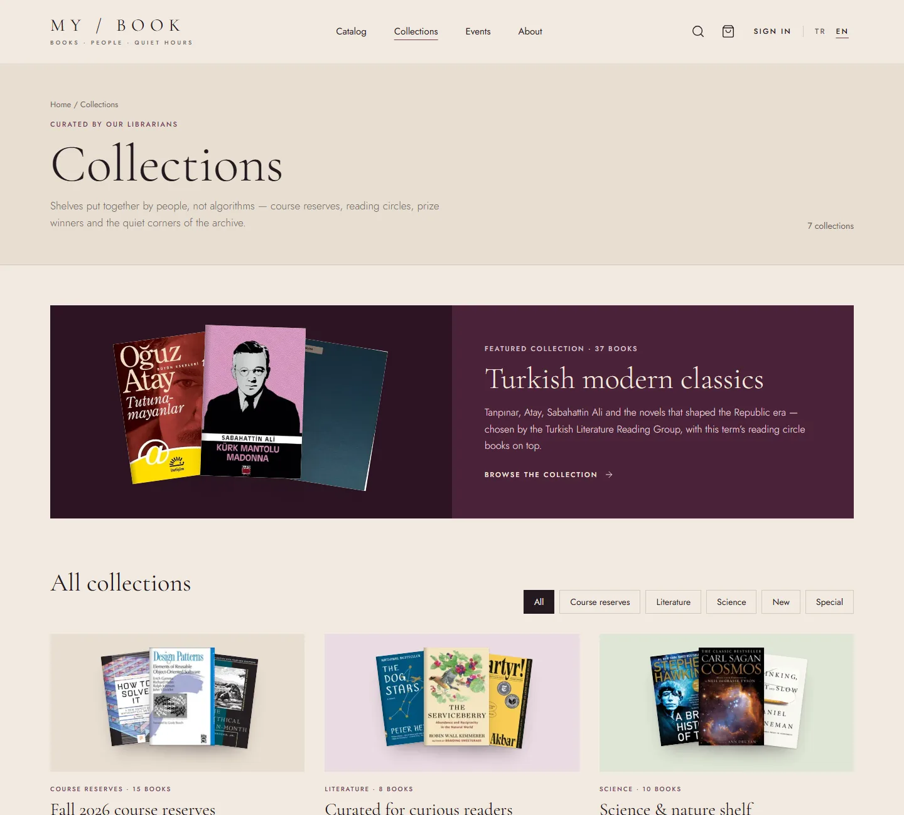
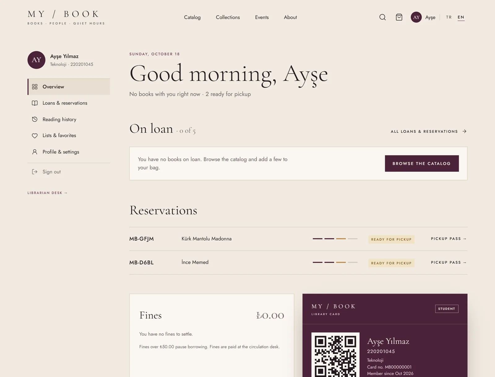
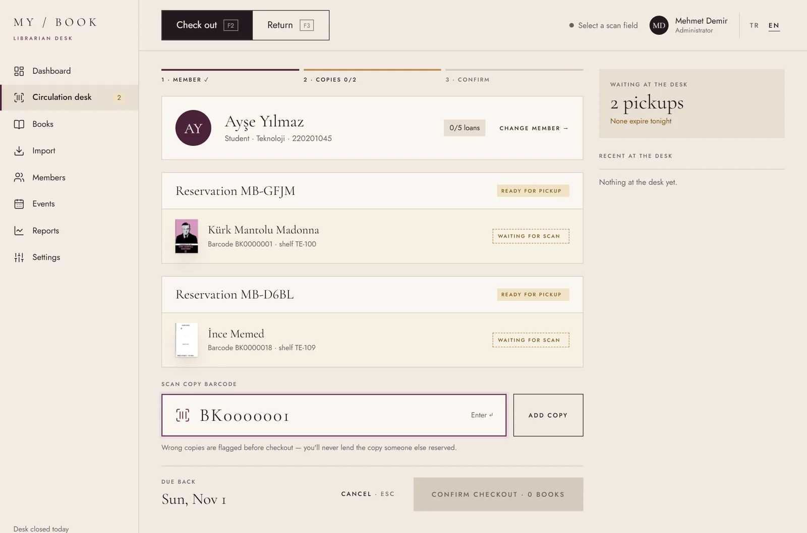
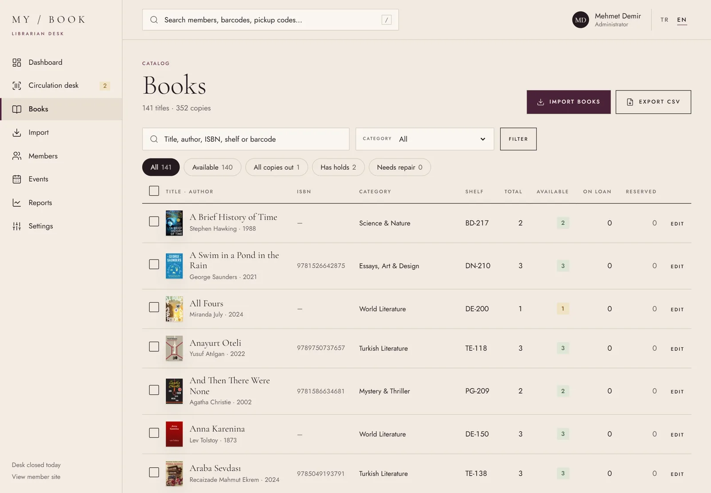
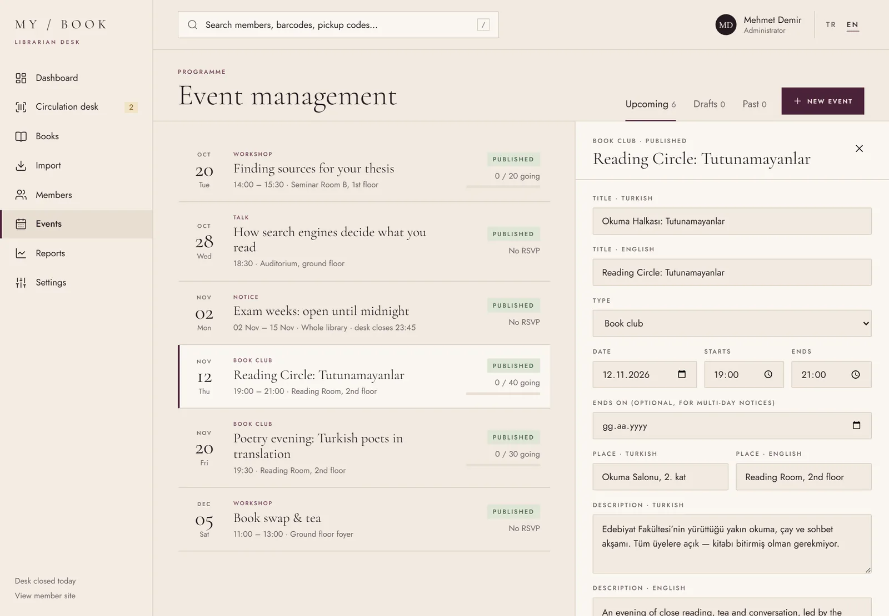
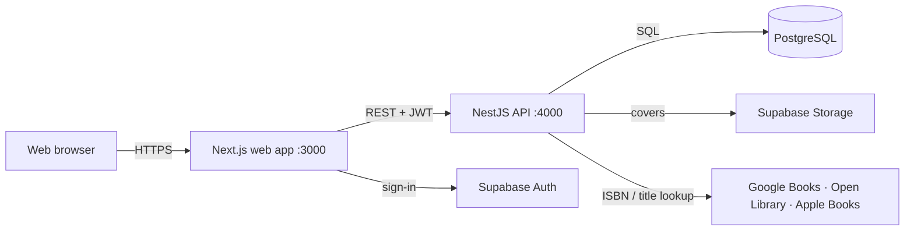

# MyBook

**English** · [Türkçe](README.tr.md)

A full-stack library system for a university library, with an editorial, bookshop-inspired interface in Turkish and
English. Members browse the catalog, reserve books online and collect them at the desk with a pickup code;
librarians run the circulation desk, import books from public book APIs, manage members and events, and follow
the numbers.



## For members

| | |
|---|---|
|  |  |
| **Catalog** — search by title, author or ISBN (Turkish letters don't matter: *kurk* finds *Kürk*), filter by category, language, year and availability. | **Book page** — copies on the shelf, on loan or on hold, the waiting list, and one button to reserve or join the queue. |
|  |  |
| **Collections** — shelves put together by librarians: course reserves, Turkish classics, science, new arrivals. | **Events** — reading circles, workshops and talks with seat reservations, a waitlist and a calendar feed. |
|  |  |
| **My account** — loans with due dates and renewals, reservations with pickup passes (QR), fines, reading history, lists and a digital library card. | **On a phone** — every page is responsive; once opened, the pickup pass and account pages also open without a connection. |

- **Borrow bag:** collect books while browsing and reserve them all at once; books reserved together share one
  pickup code.
- **Reservations:** if a copy is on the shelf it goes onto the hold shelf right away (48 hours to collect, Sundays
  don't count); otherwise the member joins the queue and gets the next copy that comes back.
- **Account:** renew loans (once, unless someone is waiting), see fines, export personal data (KVKK) and close the
  account.

## For librarians

| | |
|---|---|
|  |  |
| **Circulation desk** — find a member by card, pickup code or name; scan copies, which are checked against the reservation before anything is lent; check out several books at once; returns with condition, fines and the next reader's hold. Keyboard first: F2 / F3 / Esc. | **Books** — every title with copies on the shelf, on loan and reserved; filters, CSV export and bulk shelf, category and withdraw actions. Each record has its copies (status, condition, loan history) and an activity timeline. |
|  | |
| **Event management** — upcoming, draft and past events with seats and waitlists; a bilingual editor and attendee lists. | |

- **Dashboard:** today's numbers, loans this week, pickups, the most overdue loans and what needs attention.
- **Import:** look a book up by ISBN or title in Google Books, Open Library and Apple Books at once, pick the edition
  and the best cover, set the number of copies — or import a whole CSV of ISBNs.
- **Members:** search, filter by type, overdue or blocked; a member record with loans, reservations, fines,
  history, staff notes, blocking and roles.
- **Reports:** loans by month and category, on-time returns, most borrowed books and an overdue report with CSV.
- **Settings:** loan period, books at once, renewals, fines and pickup window, plus live connection tests for the
  book sources.

## How a loan works

```text
reserve online ─▶ copy on the hold shelf (or queue) ─▶ scanned at the desk ─▶ loan ─▶ return
```

Defaults (editable under Settings): 14-day loans, 5 books per member (loans and open reservations together), one
renewal unless someone is waiting, 48 hours to collect a held copy, ₺2.50 for each started day late. A member
with an overdue loan, unpaid fines of ₺50 or more, or a manual block cannot reserve or borrow. Uncollected holds
expire automatically and the copy goes to the next reader in line. Every rule is enforced in one database
transaction that locks the member and the copies involved.

## Tech stack

| Layer | Technology |
|---|---|
| Web | Next.js 16 (App Router, Cache Components, server actions), React 19, TypeScript, Tailwind CSS 4 |
| API | NestJS, Prisma 7, Zod validation |
| Database & storage | Supabase: PostgreSQL, Auth (JWT verified with the public JWKS), Storage for covers |
| Book data | Google Books, Open Library, Apple Books |
| Tooling | pnpm workspaces, Turborepo, Vitest with PGlite, ESLint / oxlint |

The browser only talks to the web server; the web server calls the API with the user's token; only the API talks to
the database.



UML diagrams of the system (class, object, package and deployment) are in [`docs/uml`](docs/uml).

## Getting started

Requirements: Node.js 22+, pnpm, a Supabase project and (optionally) a Google Books API key.

```bash
pnpm install
cp .env.example .env                        # then fill in the values
pnpm --filter @mybook/api db:migrate
pnpm --filter @mybook/api db:seed           # categories, ~150 books with covers, copies, events, collections
pnpm dev                                    # web → http://localhost:3000 · API → http://localhost:4000/api
```

Sign up in the web app, then give yourself the librarian or admin role (the librarian panel is at `/en/admin`):

```bash
pnpm --filter @mybook/api user:role you@example.edu ADMIN
```

Other commands: `pnpm test`, `pnpm lint`, `pnpm typecheck`, `pnpm build`, and
`pnpm --filter @mybook/api db:seed:collections` to rebuild only the collections (stop `pnpm dev` first).

## Tests

`pnpm test` runs unit tests and integration tests against **PGlite** (Postgres compiled to WebAssembly) with every
migration applied, so database constraints, triggers and the circulation rules are tested together — no Docker or
test database needed. Time-dependent rules run on a fake clock.

## Project structure

| Path | What it is |
|---|---|
| `apps/web` | Next.js app: member site (`app/[lang]/(site)`), sign-in (`(auth)`) and librarian panel (`admin`) |
| `apps/api` | NestJS API: `catalog`, `circulation`, `account`, `members`, `events`, `books`, `import` modules; Prisma schema and migrations in `prisma/` |
| `packages/shared` | Types, Zod schemas and rules shared by web and API |
| `docs/uml` | UML diagrams (Mermaid) |
| `supabase/` | Supabase CLI project config |

Some database rules (partial unique indexes, check constraints, the Supabase Auth trigger and row level security)
are raw SQL migrations because Prisma's schema language cannot express them.

## Notes

- Screenshots show real pages of the running app; the signed-in pages use demo names instead of a real account.
- The interface was designed in Claude Design and built screen by screen.

## Background

This project started as a class assignment ("Online Library Management System" — UML modelling) and grew into a
complete, production-style application. The required diagrams are in [`docs/uml`](docs/uml).
