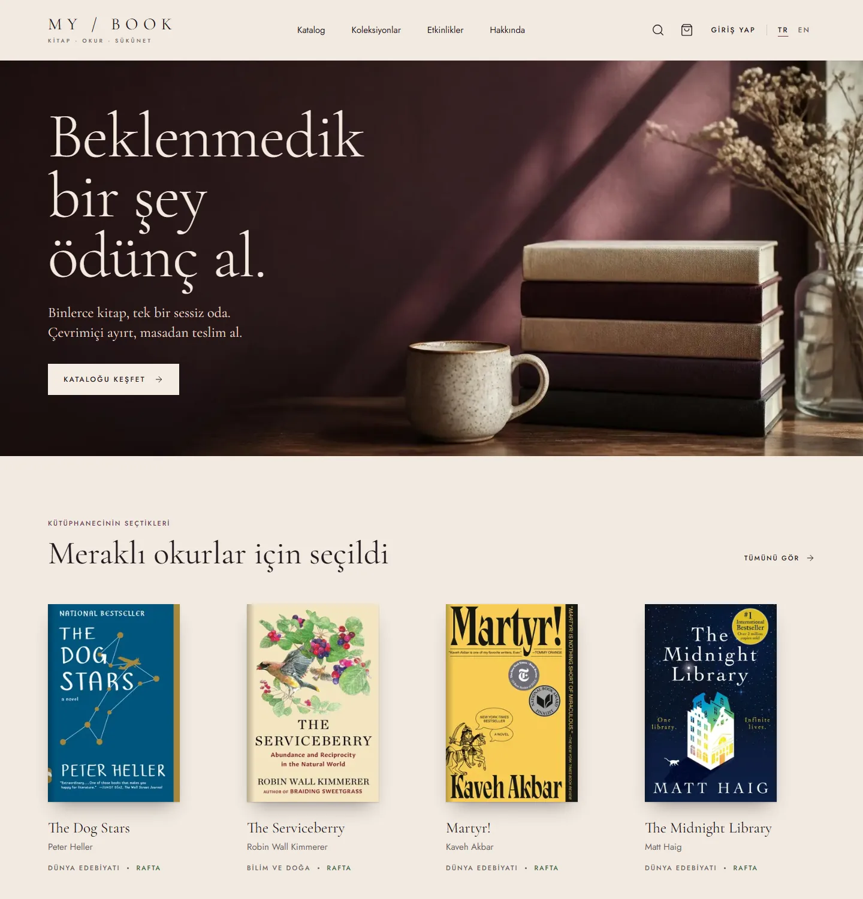
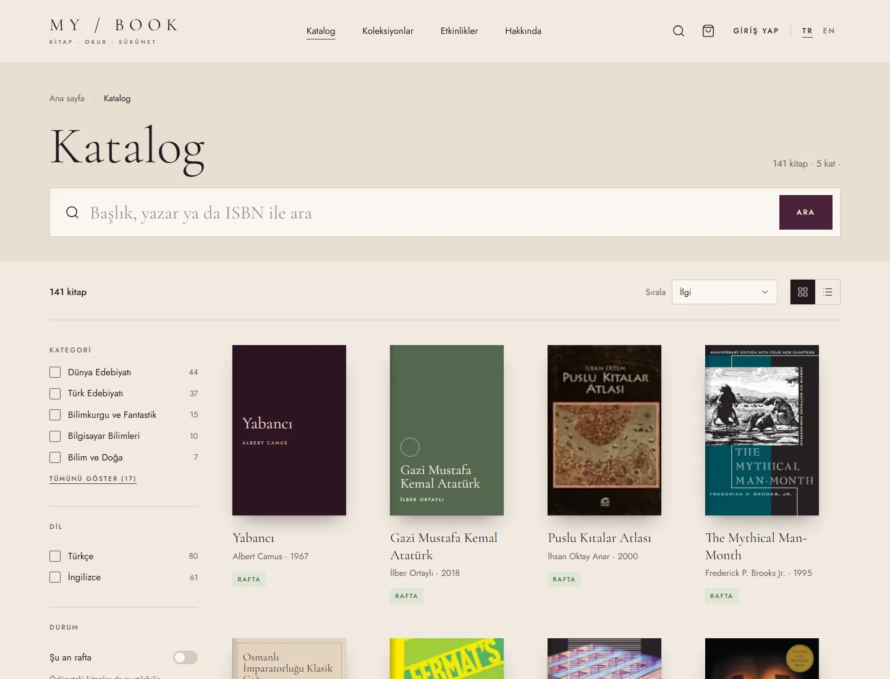
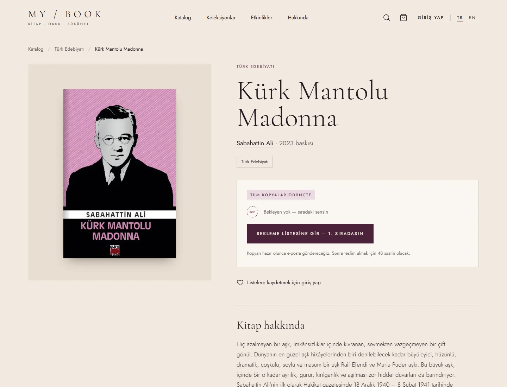
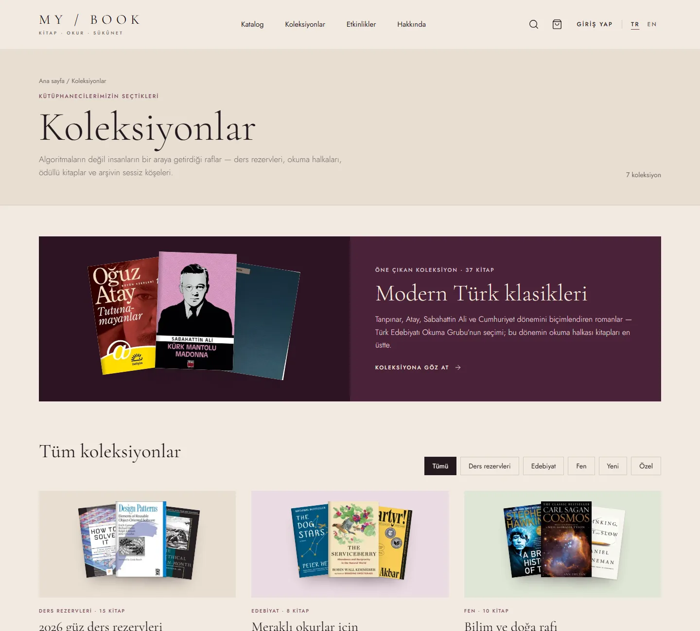
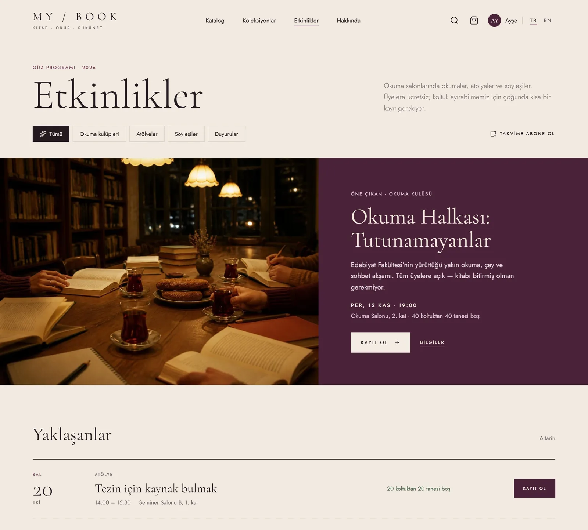
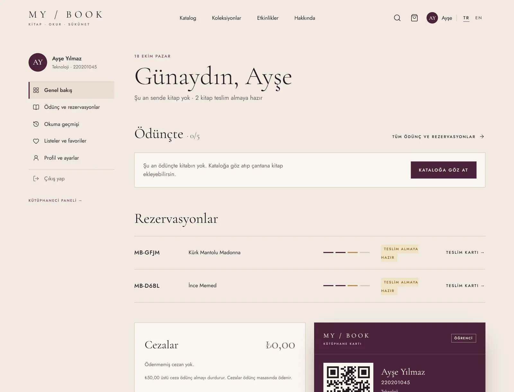
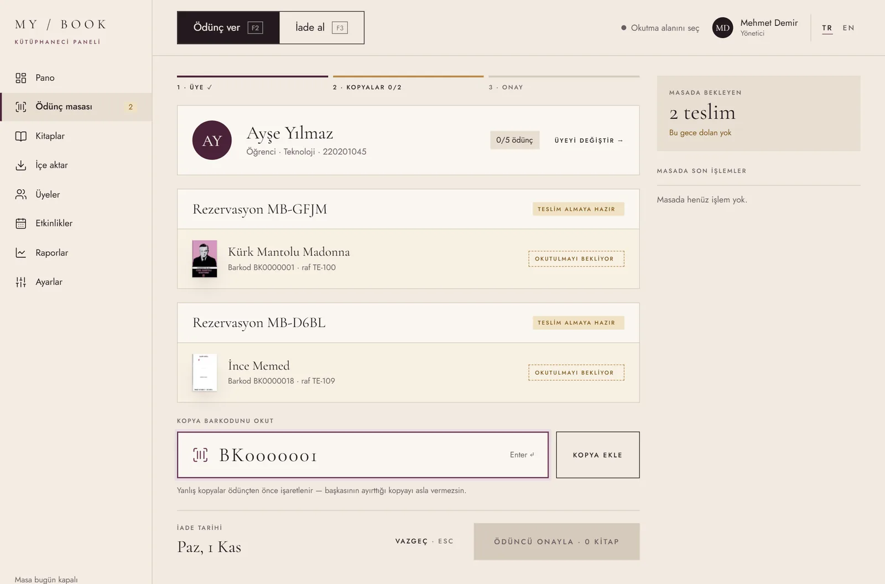
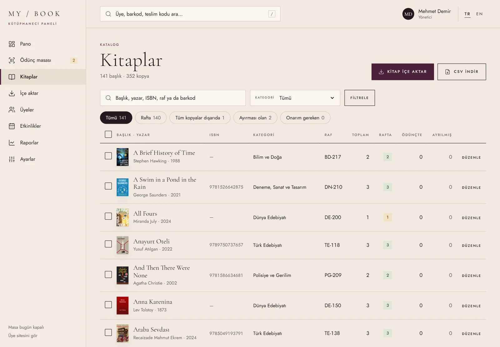
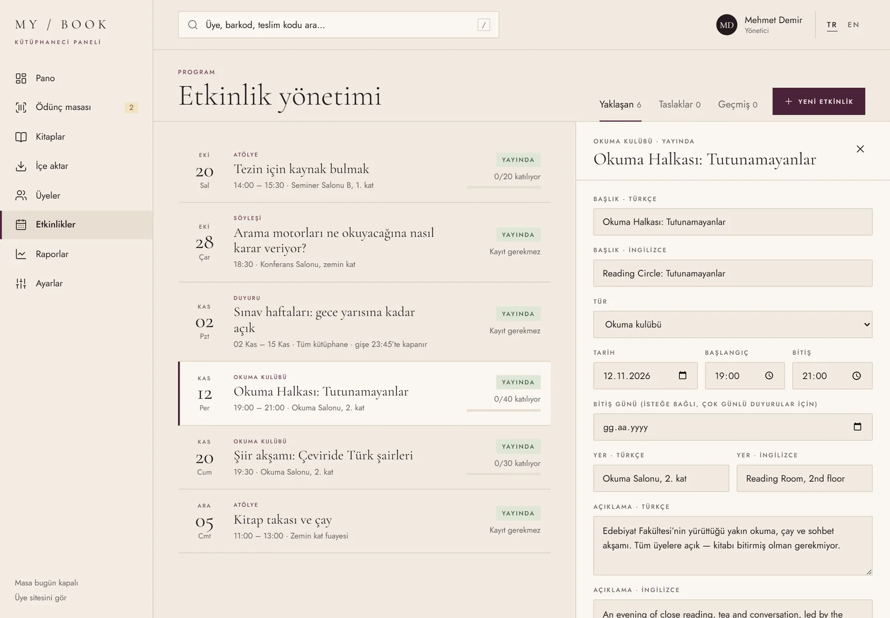
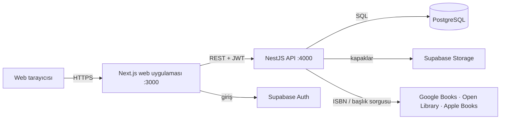

# MyBook

[English](README.md) · **Türkçe**

Bir üniversite kütüphanesi için, kitapçı estetiğinden ilham alan editoryal arayüze sahip, Türkçe ve İngilizce
full-stack kütüphane sistemi. Üyeler kataloğu gezer, kitapları online ayırtır ve gişeden teslim kodu ile alır;
kütüphaneciler ödünç masasını yönetir, kitapları açık kitap API'lerinden içe aktarır, üyeleri ve etkinlikleri
yönetir, raporları izler.



## Üyeler için

| | |
|---|---|
|  |  |
| **Katalog** — başlık, yazar ya da ISBN ile arama (Türkçe karakterler fark etmez: *kurk* yazınca *Kürk* bulunur); kategori, dil, yıl ve rafta olma durumuna göre filtre. | **Kitap sayfası** — raftaki, ödünçteki ve ayrılmış kopyalar, bekleme listesi; tek düğmeyle ayırtma ya da sıraya girme. |
|  |  |
| **Koleksiyonlar** — kütüphanecilerin hazırladığı raflar: ders rezervleri, Türk klasikleri, bilim, yeni gelenler. | **Etkinlikler** — okuma halkaları, atölyeler ve söyleşiler; koltuk ayırtma, bekleme listesi ve takvim aboneliği. |
|  |  |
| **Hesabım** — son günleri ve yenilemeleriyle ödünçler, teslim kartlı (QR) rezervasyonlar, cezalar, okuma geçmişi, listeler ve dijital kütüphane kartı. | **Telefonda** — tüm sayfalar mobil uyumlu; bir kez açılan teslim kartı ve hesap sayfaları bağlantı yokken de açılır. |

- **Ödünç çantası:** gezinirken kitapları topla, hepsini tek seferde ayırt; birlikte ayırtılan kitaplar tek bir
  teslim kodunu paylaşır.
- **Rezervasyon:** rafta kopya varsa hemen ayırma rafına konur (teslim için 48 saat, Pazar sayılmaz); yoksa üye
  sıraya girer ve geri gelen ilk kopya ona ayrılır.
- **Hesap:** ödünç yenileme (bekleyen yoksa bir kez), cezaları görme, kişisel verileri indirme (KVKK) ve hesabı
  kapatma.

## Kütüphaneciler için

| | |
|---|---|
|  |  |
| **Ödünç masası** — üyeyi kart, teslim kodu ya da adla bul; kopyaları okut (ödünç vermeden önce rezervasyonla karşılaştırılır), birden çok kitabı tek seferde ver; iadede kondisyon, ceza ve sıradaki okur için ayırma. Klavye öncelikli: F2 / F3 / Esc. | **Kitaplar** — her başlık için raftaki, ödünçteki ve ayrılmış kopyalar; filtreler, CSV dışa aktarma, toplu raf, kategori ve kayıttan düşme. Her kayıtta kopyalar (durum, kondisyon, ödünç geçmişi) ve hareket geçmişi. |
|  | |
| **Etkinlik yönetimi** — yaklaşan, taslak ve geçmiş etkinlikler; koltuklar ve bekleme listeleri, iki dilli düzenleyici ve katılımcı listeleri. | |

- **Pano:** günün sayıları, bu haftaki ödünçler, teslimler, en çok gecikenler ve ilgilenilmesi gerekenler.
- **İçe aktarma:** bir kitabı ISBN ya da başlıkla Google Books, Open Library ve Apple Books'ta aynı anda ara;
  baskıyı ve en iyi kapağı seç, kopya sayısını belirle — ya da bir ISBN CSV'sinin tamamını aktar.
- **Üyeler:** arama; tür, gecikme ve engel filtreleri; ödünçleri, rezervasyonları, cezaları, geçmişi, personel
  notları, engelleme ve rolleriyle üye kaydı.
- **Raporlar:** aylara ve kategorilere göre ödünç, zamanında iade oranı, en çok ödünç alınanlar ve CSV'li gecikme
  raporu.
- **Ayarlar:** ödünç süresi, aynı anda kitap sayısı, yenileme, cezalar ve teslim süresi; kitap kaynakları için canlı
  bağlantı testi.

## Ödünç nasıl işler

```text
online ayırt ─▶ kopya ayırma rafına (ya da sıraya) ─▶ gişede okutulur ─▶ ödünç ─▶ iade
```

Varsayılanlar (Ayarlar'dan değiştirilebilir): 14 günlük ödünç, üye başına 5 kitap (ödünçler ve açık rezervasyonlar
birlikte), bekleyen yoksa bir yenileme, ayrılan kopyayı almak için 48 saat, geciken her gün için ₺2,50. Gecikmiş
ödüncü, ₺50 ve üzeri ödenmemiş cezası olan ya da elle engellenen üye ayırtamaz ve ödünç alamaz. Alınmayan
ayırmaların süresi kendiliğinden dolar ve kopya sıradaki okura geçer. Her kural, üyeyi ve ilgili kopyaları kilitleyen
tek bir veritabanı işleminde uygulanır.

## Teknolojiler

| Katman | Teknoloji |
|---|---|
| Web | Next.js 16 (App Router, Cache Components, server actions), React 19, TypeScript, Tailwind CSS 4 |
| API | NestJS, Prisma 7, Zod doğrulama |
| Veritabanı ve depolama | Supabase: PostgreSQL, Auth (JWT, açık JWKS ile doğrulanır), kapaklar için Storage |
| Kitap verisi | Google Books, Open Library, Apple Books |
| Araçlar | pnpm workspaces, Turborepo, PGlite ile Vitest, ESLint / oxlint |

Tarayıcı yalnızca web sunucusuyla konuşur; web sunucusu API'yi kullanıcının jetonuyla çağırır; veritabanına
yalnızca API erişir.



Sistemin UML diyagramları (sınıf, nesne, paket ve dağıtım) [`docs/uml`](docs/uml) klasöründe.

## Kurulum

Gerekenler: Node.js 22+, pnpm, bir Supabase projesi ve (isteğe bağlı) Google Books API anahtarı.

```bash
pnpm install
cp .env.example .env                        # ardından değerleri doldur
pnpm --filter @mybook/api db:migrate
pnpm --filter @mybook/api db:seed           # kategoriler, kapaklı ~150 kitap, kopyalar, etkinlikler, koleksiyonlar
pnpm dev                                    # web → http://localhost:3000 · API → http://localhost:4000/api
```

Web uygulamasından kaydol, sonra kendine kütüphaneci ya da yönetici rolü ver (kütüphaneci paneli `/tr/admin`):

```bash
pnpm --filter @mybook/api user:role sen@ornek.edu ADMIN
```

Diğer komutlar: `pnpm test`, `pnpm lint`, `pnpm typecheck`, `pnpm build`; yalnızca koleksiyonları yeniden
oluşturmak için `pnpm --filter @mybook/api db:seed:collections` (önce `pnpm dev`'i durdur).

## Testler

`pnpm test` birim testlerini ve tüm migration'ları uygulanmış **PGlite** (WebAssembly'ye derlenmiş Postgres)
üzerinde entegrasyon testlerini çalıştırır; böylece veritabanı kısıtları, tetikleyiciler ve ödünç kuralları birlikte
test edilir — Docker ya da test veritabanı gerekmez. Zamana bağlı kurallar sahte bir saatle çalışır.

## Proje yapısı

| Yol | Ne |
|---|---|
| `apps/web` | Next.js uygulaması: üye sitesi (`app/[lang]/(site)`), giriş (`(auth)`) ve kütüphaneci paneli (`admin`) |
| `apps/api` | NestJS API: `catalog`, `circulation`, `account`, `members`, `events`, `books`, `import` modülleri; Prisma şeması ve migration'lar `prisma/` içinde |
| `packages/shared` | Web ve API'nin paylaştığı tipler, Zod şemaları ve kurallar |
| `docs/uml` | UML diyagramları (Mermaid) |
| `supabase/` | Supabase CLI proje ayarları |

Bazı veritabanı kuralları (kısmi unique index'ler, check kısıtları, Supabase Auth tetikleyicisi ve satır düzeyinde
güvenlik) Prisma şema dili bunları ifade edemediği için ham SQL migration olarak yazıldı.

## Notlar

- Ekran görüntüleri çalışan uygulamanın gerçek sayfalarıdır; giriş gerektiren sayfalarda gerçek bir hesap yerine
  demo isimler kullanıldı.
- Arayüz Claude Design'da tasarlandı ve ekran ekran uygulandı.

## Arka plan

Bu proje bir ders ödevi olarak başladı ("Online Kütüphane Yönetim Sistemi" — UML modelleme) ve eksiksiz,
üretim düzeyinde bir uygulamaya dönüştü. İstenen diyagramlar [`docs/uml`](docs/uml) klasöründe.

## Lisans

[MIT](LICENSE): bu depodaki kodu, UML diyagramlarını, ekran görüntülerini ve fotoğrafları, lisans notunu yanlarında
tuttuğun sürece kendi projelerin dahil özgürce kullanabilir, kopyalayabilir, değiştirebilir ve paylaşabilirsin.
Kitap bilgileri ve kapaklar depoda yer almaz; uygulama onları Google Books, Open Library ve Apple Books'tan çeker ve
hakları yayıncılarına aittir.
