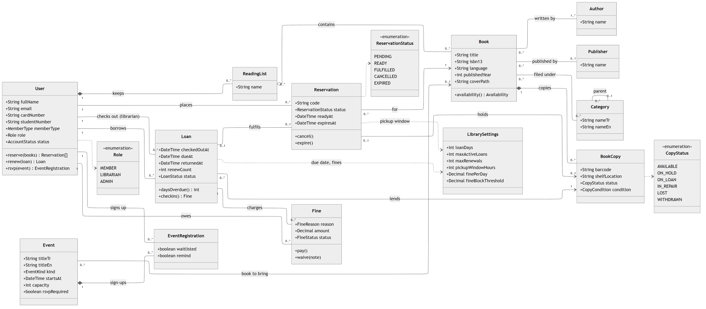
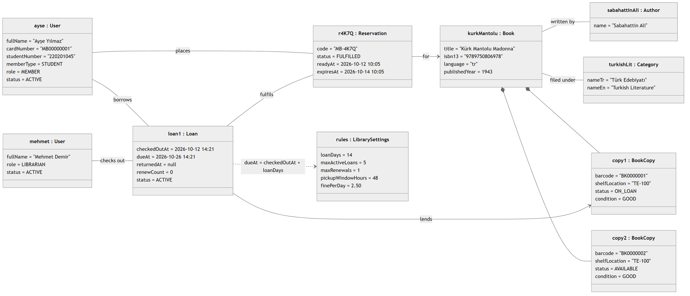
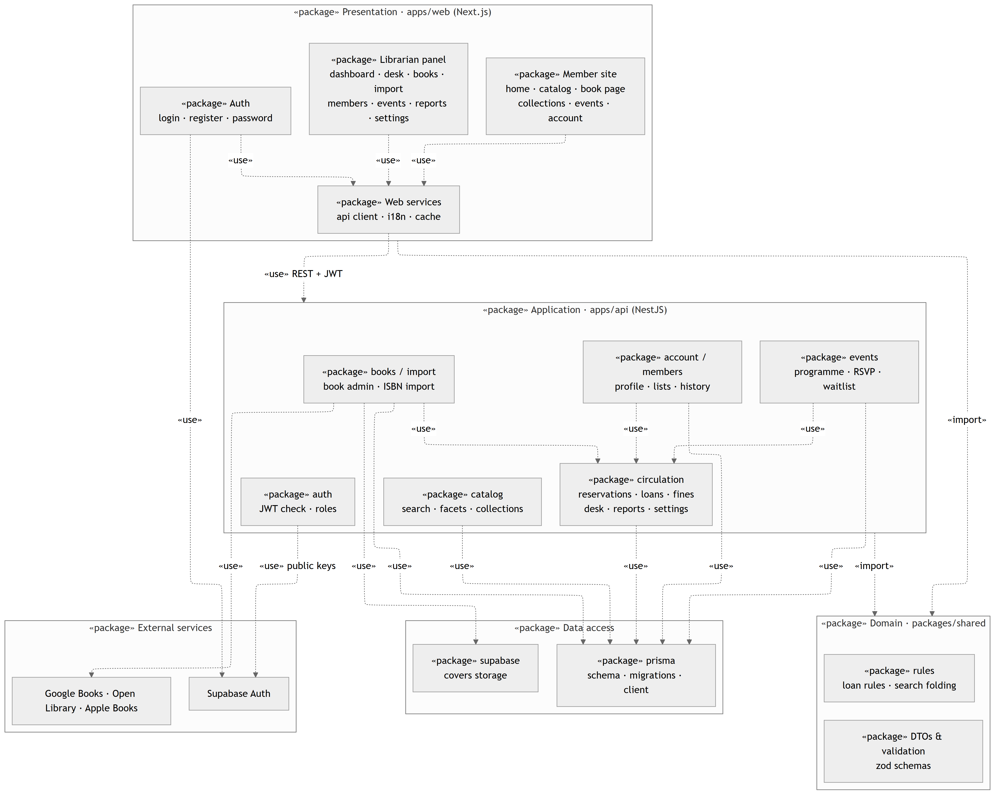
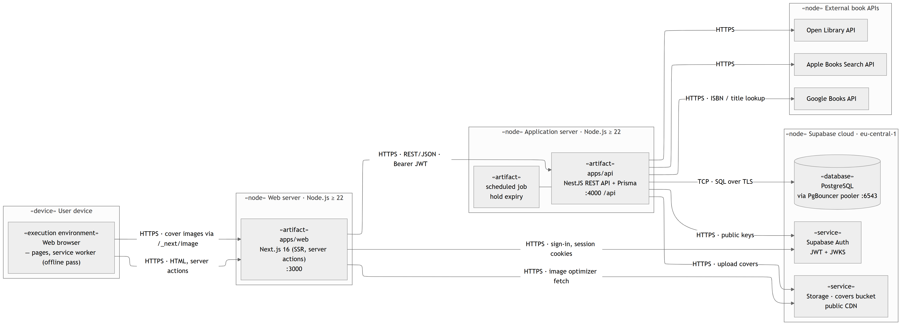

# UML diyagramları · UML diagrams

Diyagramlar [Mermaid](https://mermaid.js.org/) ile yazıldı ve uygulamanın gerçek veri modelinden ([`schema.prisma`](../../apps/api/prisma/schema.prisma)) ile klasör yapısından çıkarıldı. Yazdırmaya uygun, yüksek çözünürlüklü PNG halleri [`png/`](png) klasöründe ve aşağıda.

*The diagrams are written in Mermaid and taken from the app's real data model and folder layout. Print-ready, high-resolution PNGs are in [`png/`](png) and below.*

| Dosya · File | Diyagram | Ödevdeki karşılığı · Assignment requirement |
| --- | --- | --- |
| [`class-diagram.mmd`](class-diagram.mmd) | Sınıf diyagramı · Class diagram | 13 sınıf ve 3 sayım (enumeration); her ilişkide çokluk (`1`, `0..1`, `0..*`, `1..*`). *13 classes and 3 enumerations, multiplicities on every association.* |
| [`object-diagram.mmd`](object-diagram.mmd) | Nesne diyagramı · Object diagram | Bir öğrencinin (Ayşe Yılmaz) ödünç aldığı kitap: rezervasyon, kopya, ödünç ve görevli kütüphaneci. *One student's borrowed book: reservation, copy, loan and the librarian who lent it.* |
| [`package-diagram.mmd`](package-diagram.mmd) | Paket diyagramı · Package diagram | 5 mantıksal paket (Sunum, Uygulama, Alan, Veri erişimi, Dış servisler) ve içlerindeki gerçek modüller. *5 logical packages with the real modules inside them.* |
| [`deployment-diagram.mmd`](deployment-diagram.mmd) | Dağıtım diyagramı · Deployment diagram | Web sunucusu (Next.js), API sunucusu (NestJS) ve veritabanı (Supabase PostgreSQL) ayrı düğümler; aralarındaki protokoller. *Web, API and database as separate nodes, with the protocols between them.* |

## Sınıf diyagramı · Class diagram



## Nesne diyagramı · Object diagram



## Paket diyagramı · Package diagram



## Dağıtım diyagramı · Deployment diagram



## Notlar · Notes

- Mermaid'de nesne, paket ve dağıtım diyagramı türleri yok. Nesne diyagramı `classDiagram` ile "nesne : Sınıf" kutuları ve öznitelik değerleriyle; paket ve dağıtım diyagramları `flowchart` ile iç içe çerçeveler ve UML stereotipleriyle (`«package»`, `«node»`, `«artifact»`, `«database»`) çizildi. *Mermaid has no object, package or deployment diagram types; they are drawn with `classDiagram` and `flowchart` plus UML stereotypes.*
- Sınıf diyagramında `User`, koddaki `Profile` modelidir; üye, kütüphaneci ve yönetici aynı sınıftır ve `role` alanıyla ayrılır. *`User` is the `Profile` model; members, librarians and admins share it and differ by `role`.*
- Ara tablolar (`BookAuthor`, `BookCategory`, `CollectionItem` …) çoktan çoğa ilişkiler olarak gösterildi. *Join tables are shown as many-to-many associations.*
- PNG'ler [mermaid-cli](https://github.com/mermaid-js/mermaid-cli) ile üretildi; sınıf, paket ve dağıtım diyagramlarında daha düzenli çizgiler için ELK yerleşimi kullanıldı. Bir `.mmd` dosyasını değiştirdikten sonra yeniden üretmek için: *To regenerate a PNG after editing a diagram:*

  ```bash
  echo '{"layout":"elk"}' > elk.json
  npx -p @mermaid-js/mermaid-cli@11.12.0 mmdc -c elk.json -i docs/uml/class-diagram.mmd -o docs/uml/png/class-diagram.png -t neutral -b white -s 3 -w 1600
  ```
